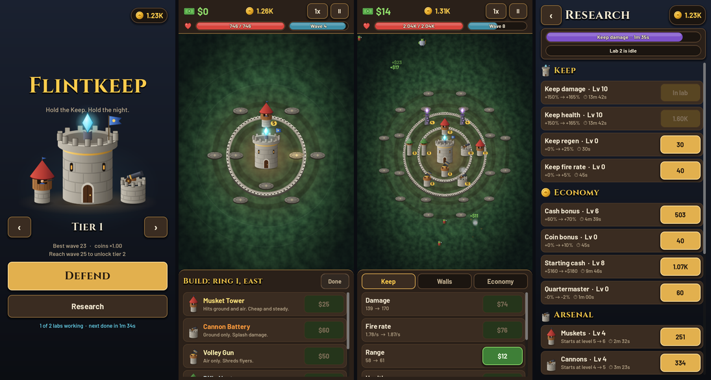

# Flintkeep

An endless fortress defense for Android and iOS, made in Godot 4.7. Hold the Keep against
goblin raiders, build a castle around it ring by ring, and research permanent upgrades between
runs. Flintlock fantasy at night: smooth vector art (SVG), Cinzel and Barlow fonts, and walnut
and brass panels.

Design: [`docs/GAME_DESIGN.md`](docs/GAME_DESIGN.md).



## Status

- [x] Endless runs: waves every 24 s, a boss every 10th wave, tiers unlocked at wave 25
- [x] The Keep plus 4 rings of build slots (4 / 6 / 8 / 12) and walls split into sections
- [x] 5 weapons (musket, cannon, volley gun, rifle nest, arcane spire), armour and ward
- [x] 6 enemies (raider, runner, brute, war balloon, wyvern, juggernaut)
- [x] Cash upgrades during a run: Keep, walls, economy (bounty, coin bounty, interest)
- [x] Coins and research with 2 timed labs that keep running while the game is closed
- [x] Saving, best wave per tier, coins banked every wave
- [x] Screens: menu, battle (HUD, field, upgrade panel, slot sheet, pause, summary), research
- [x] Vector art for the Keep, 5 towers, build foundations, 6 enemies and icons; continuous ring
      walls; gradients on the courtyard, tower range and shot tracers
- [x] Tests (rules, research, saves, number formatting) and a balance check that plays whole runs
- [ ] Sound and music
- [ ] Tutorial, settings, store screenshots
- [ ] More content (see "Not built yet" in the design doc)

## Run it

Install Godot 4.7 (`brew install --cask godot`), then open `godot/project.godot` in the editor
and press F5, or run it from a terminal:

```bash
godot --path godot
```

On desktop the mouse acts as a finger. Tap a stone plate around the Keep to build there, and
tap a built tower to upgrade or sell it.

## Test it

```bash
./test.sh            # everything (about 15 s; the balance tests play whole runs)
./test.sh battle     # only tests whose file or name contains "battle"
```

The script finds Godot at `/Applications/Godot.app` or on your `PATH`, or you can set `GODOT_BIN`.

Developer tools (run from `godot/`):

```bash
godot --headless --path . -s ../tools/balance.gd     # waves and coins per research setup
godot --path . -s ../tools/flow_check.gd             # clicks through menu > battle > summary > research
godot --path . --resolution 540x1170 -s ../tools/screenshot.gd -- battle /tmp/b.png wait=20 auto=1 speed=3 research=late
```

## Phone builds

The export presets for Android and iOS are in `godot/export_presets.cfg` (bundle id
`com.verjlabs.flintkeep`). You need the Godot export templates. For Android you also need the
Android SDK and JDK 17; for iOS you need a Mac with Xcode.

```bash
cd godot
godot --headless --export-debug "Android" builds/android/Flintkeep.apk
godot --headless --export-debug "iOS" builds/ios/Flintkeep.ipa    # writes an Xcode project
```

## Art and fonts

- Sprites are SVG files in `godot/assets/art/`, written by `python3 tools/make_art.py`. Edit
  the script and re-run it, or replace a file by hand: keep its canvas size and the point it
  stands on (`FOOT` in `godot/ui/art.gd`, which also sets how wide each sprite is on the
  battlefield). The game rasterises them at 3x with mipmaps, so they stay sharp at any zoom.
- Walls, the ground, glows and effects are drawn in code (`game/wall_drawer.gd`,
  `game/battle_view.gd`, `game/field_fx.gd`).
- Fonts are in `godot/assets/fonts/`: Cinzel for headings, Barlow for everything else. Both are
  under the SIL Open Font License, and the licence files are next to them.

## Layout

```
docs/GAME_DESIGN.md  what the game is and why; numbers live in code
godot/core/          rules: no nodes or drawing (Battle, research, profile, waves, AutoPlayer)
godot/game/          the battlefield view: ground, walls, sprites, shots, glow, particles
godot/ui/            screens, panels, fonts, the art loader, the Profile autoload
godot/assets/        SVG art and fonts
godot/tests/         tests (run by tools/run_tests.gd)
tools/               art generator, test runner, balance report, flow check, screenshots
```

Ground rules:

1. `core/` never touches nodes, scenes or timers. `Battle.step(dt)` advances the game, and the
   view only reads the state and the events it emits. The same code runs the game, the tests
   and the balance simulation.
2. Tuning numbers go in `core/defs.gd` or `core/research.gd`, not in UI code.
3. After changing balance, run `./test.sh` and `tools/balance.gd`.
