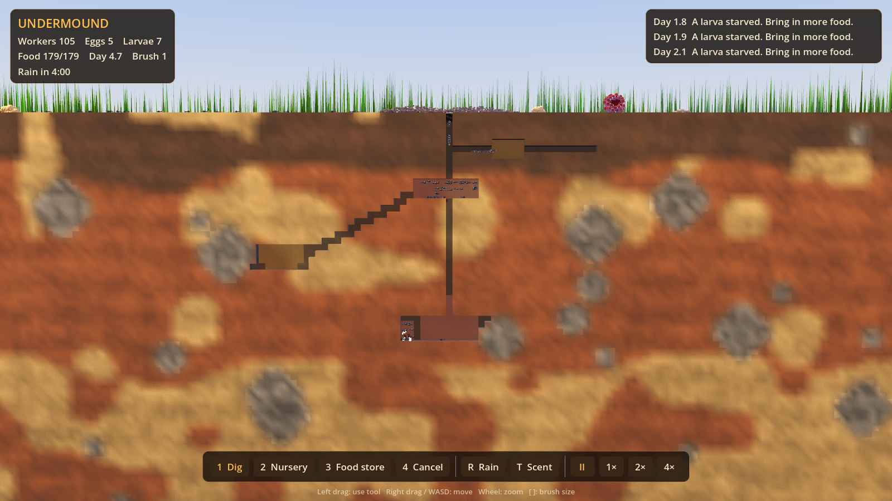
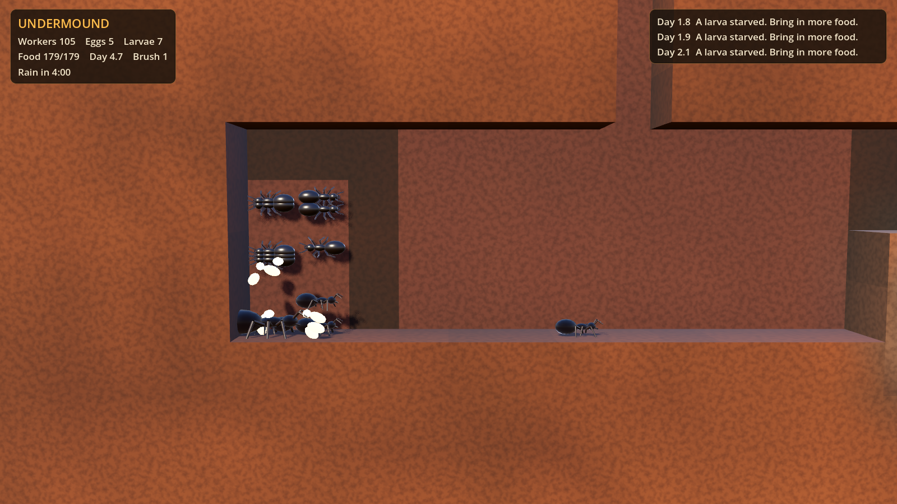
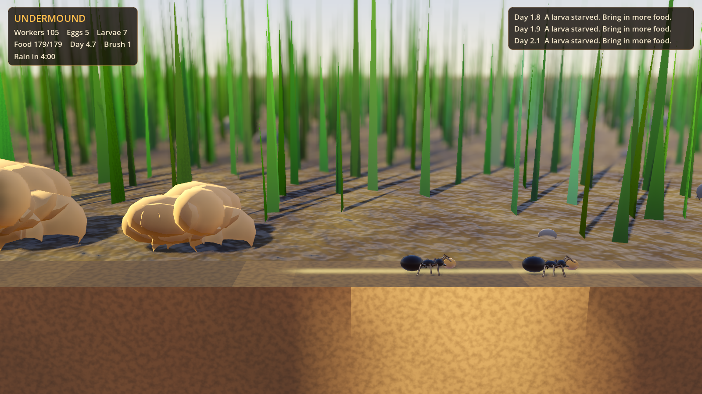
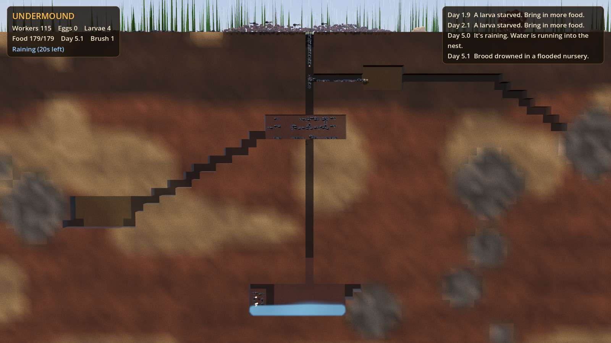
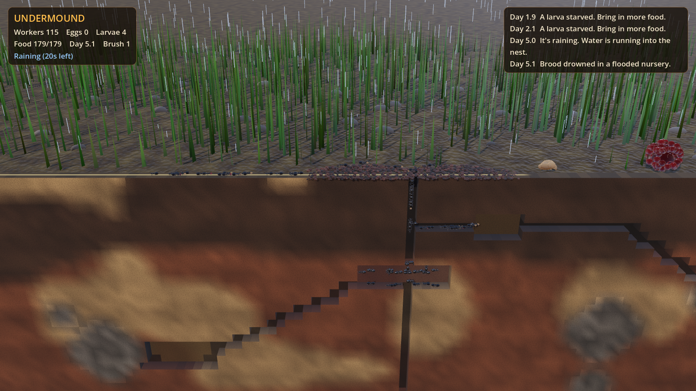

# Undermound

A 3D colony sim inside a living glass ant farm. Dig the nest, mark nurseries and food stores, and
watch thousands of ants forage, raise brood and survive the rain. *Every tunnel you dig, your
colony fills.*

Design: [`docs/GAME_DESIGN.md`](docs/GAME_DESIGN.md). Decisions: [`docs/DECISIONS.md`](docs/DECISIONS.md).



| | |
|---|---|
|  |  |
|  |  |

Built in **Godot 4.7 with C#** (.NET 8). The simulation (`godot/core/`) is plain C# with no Godot
types, so it can move to Unity later; the 3D view is in `godot/game/`.

## Status: 0.1, first playable

- [x] Dig tunnels by painting; ants dig, carry soil up and build a mound
- [x] Foragers search the surface, bring food home and lay scent trails that fade
- [x] Food store and nursery rooms; the queen lays eggs; eggs → larvae → workers
- [x] Rain: water pours into the entrance, runs down tunnels, pools and soaks away; flooded brood dies;
      the mound around the entrance shelters it; the sky greys and rain falls
- [x] 3D ant farm: soil layers with rocks, hollow tunnels, room tints, a wooden frame, a macro garden
      on top with towering grass and food; ants with walking legs that crawl on the back wall off the floor
- [x] HUD, tools, game speed, camera pan and zoom
- [x] 17 core tests and a screenshot script

Not built yet: priorities, scent painting, seasons, predators, the nuptial flight, sound, a proper
ant walk cycle and soil art beyond the cell grid (see the design doc).

## Run it

Needs Godot 4.7 **.NET** edition and the .NET 8 SDK.

```bash
cd godot
dotnet build              # compile the C#
godot --path .            # or open project.godot in the Godot editor and press F5
```

Controls: left drag to use the current tool (Shift + drag erases), right drag or WASD to pan,
mouse wheel to zoom, 1–4 for tools (Dig, Nursery, Food store, Cancel), `[` `]` for brush size,
R for rain, T to show scent trails, Space to pause, `+`/`-` for speed.

## Tests and screenshots

```bash
./tools/test.sh                 # core simulation tests, no engine needed
./tools/screenshots.sh out/     # renders a scripted scene to PNGs (needs xvfb on Linux)
```
